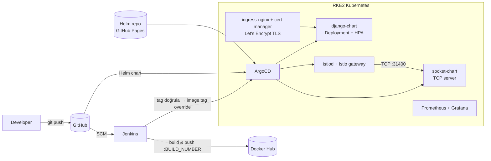

# Kubernetes GitOps Platform — Jenkins · ArgoCD · Helm · Istio


RKE2 tabanlı bir Kubernetes cluster üzerinde iki uygulamayı (Django web uygulaması + uzun ömürlü TCP soket sunucusu) **GitOps** yaklaşımıyla yöneten uçtan uca bir platform. Kod push'landığında Jenkins imajı derler, Docker Hub'a gönderir ve ArgoCD üzerinden cluster'a dağıtır; cluster'daki durum her zaman Git'teki tanımla senkron tutulur.

## Mimari



## Öne çıkanlar

- **GitOps ile dağıtım:** Tüm uygulamalar ArgoCD `Application` kaynaklarıyla tanımlı; `automated` sync, `prune` ve `selfHeal` açık. Cluster'da elle yapılan değişiklikler otomatik geri alınır.
- **Güvenli CI → CD geçişi:** Jenkins, ArgoCD'deki `image.tag` parametresini değiştirmeden önce imajın Docker Hub'da gerçekten var olduğunu doğrular; olmayan bir tag yüzünden cluster'ın `ImagePullBackOff`'a düşmesi engellenir. Git geçmişini kirleten "bot commit" yerine ArgoCD parameter override kullanılır.
- **Kendi Helm chart'ları:** `django-chart` ve `socket-chart` sıfırdan yazıldı; `socket-chart` sürümlenerek **GitHub Pages üzerinde Helm repository** olarak yayınlanıyor (`gh-pages` branch'i).
- **Secret yönetimi:** Django `SECRET_KEY` Helm şablonunda rastgele üretilir ve `lookup` ile mevcut Secret korunur; her deploy'da anahtar değişip oturumlar düşmez.
- **Istio ile uzun ömürlü TCP:** Soket sunucusu Istio gateway (port 31400) arkasında çalışır. 10 dakikalık keepalive testinde bağlantı kesintisiz açık kaldı → [`docs/long-lived-tcp-test.log`](docs/long-lived-tcp-test.log).
- **TLS ve gözlemlenebilirlik:** cert-manager + Let's Encrypt `ClusterIssuer` ile otomatik HTTPS; Prometheus/Grafana stack'i ingress üzerinden erişilebilir.

## Klasör yapısı

| Yol | İçerik |
|---|---|
| `Jenkinsfile` | Build → push → tag doğrulama → ArgoCD override |
| `argocd-*.yaml` | ArgoCD Application tanımları (django, socket, istio, gateway) |
| `deployments/django-chart/` | Django Helm chart'ı (Deployment, Service, Ingress, HPA, Secret) |
| `deployments/socket-chart/` | TCP soket sunucusu chart'ı (Istio Gateway / VirtualService) |
| `deployments/cluster-issuer.yaml` | Let's Encrypt ClusterIssuer |
| `monitoring/` | Grafana ingress |
| `app/` | Asenkron Python TCP sunucusu ve keepalive test scripti |
| `core/`, `templates/` | Django uygulaması |

## Çalıştırma

```bash
# ArgoCD kurulu bir cluster'da
kubectl apply -f deployments/cluster-issuer.yaml
kubectl apply -f argocd-istio.yaml -f argocd-istio-gateway.yaml
kubectl apply -f argocd-django-app.yaml -f argocd-app.yaml
```

Jenkins tarafında `dockerhub-cred` (Docker Hub) ve `k8s-kubeconfig` (kubeconfig dosyası) credential'ları tanımlı olmalıdır.

## Öğrendiklerim

- `latest` tag'ine güvenmek yerine build numarasıyla sürümlemenin ve deploy'dan önce artefaktı doğrulamanın önemi.
- Uzun ömürlü TCP bağlantılarının L7 ingress yerine Istio'nun L4 gateway'iyle taşınması.
- Helm chart'larını bir registry gibi yayınlayıp ArgoCD'ye sürümlü kaynak olarak vermek.
